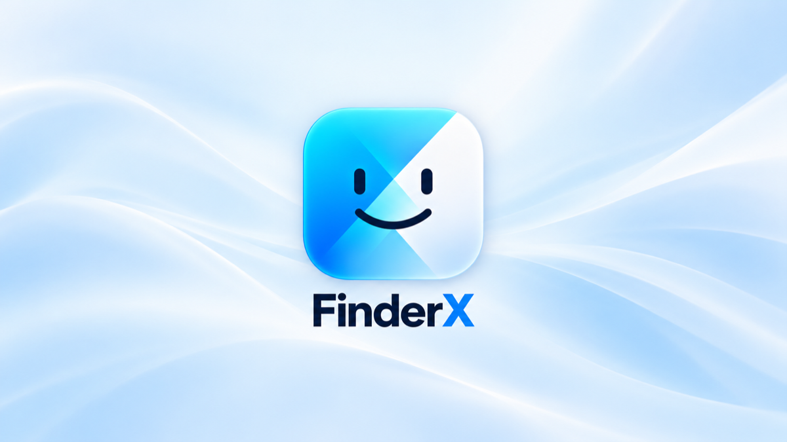
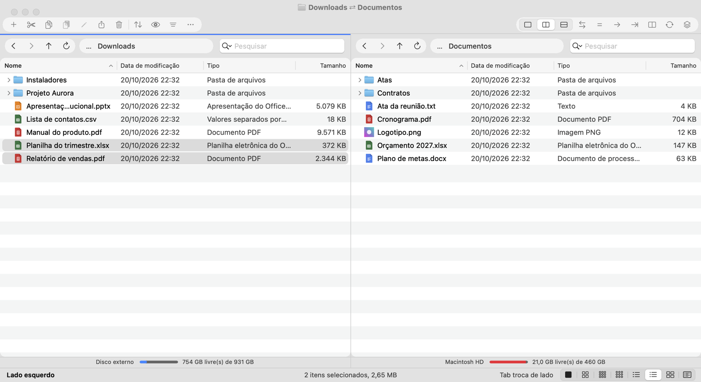
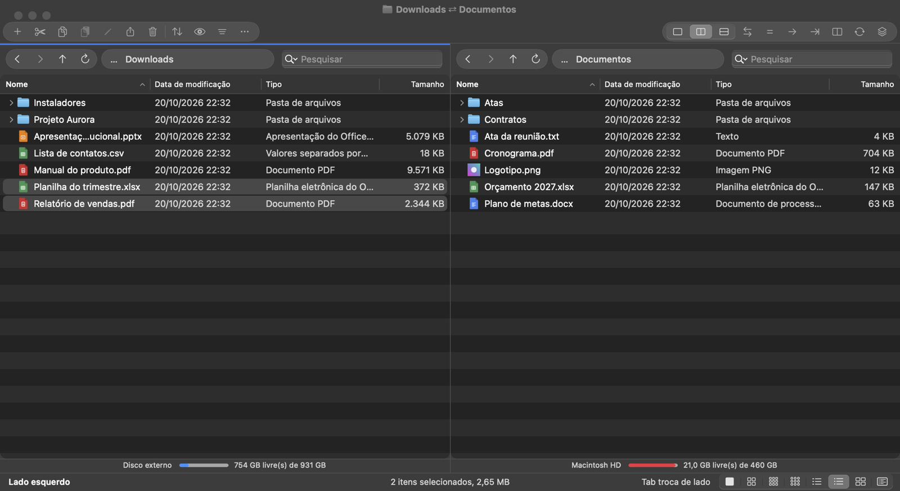
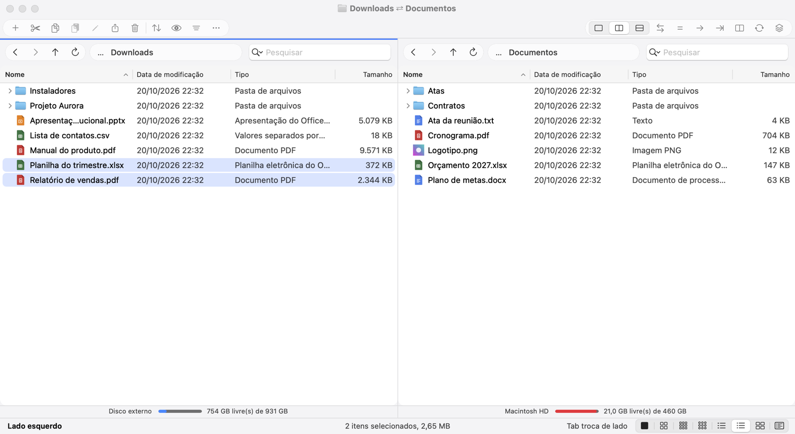
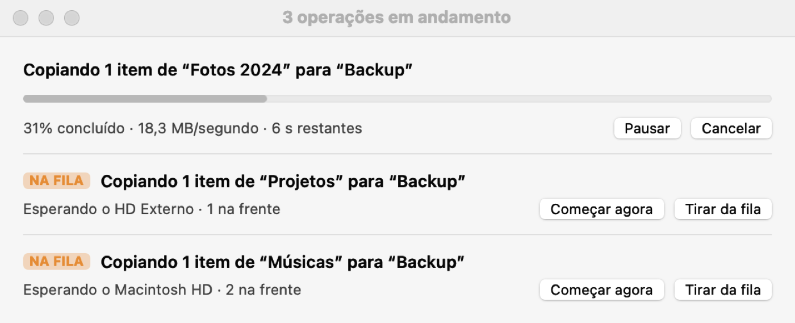
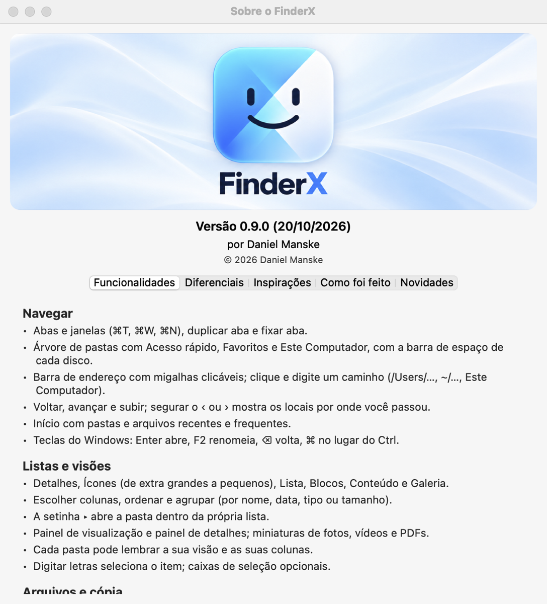

<a href="README.md">Português</a> · <a href="README.en.md">English</a> · <b>Español</b>

# FinderX

Gestor de archivos para **macOS** que funciona como el **Explorador de archivos de Windows 11**: pestañas, barra de comandos, árbol de carpetas y los atajos de Windows (con ⌘ en lugar de Ctrl). Además trae cosas que ni el Finder ni el Explorador tienen, como el **panel doble**, la **cola de copias** y la **verificación de la copia**.

Para quien viene de Windows, usa los dos sistemas o trabaja con muchos archivos y discos externos.

> Por ahora la aplicación está en portugués de Brasil.

## Descargar

Baja la versión más reciente en **[Releases](https://github.com/dmanske/FinderX/releases/latest)**:

| Tu computadora | Archivo |
|---|---|
| Mac con chip de Apple (M1, M2, M3, M4…) | `FinderX-<versión>-Mac-chip-Apple.zip` |
| Mac con procesador Intel o Hackintosh | `FinderX-<versión>-Hackintosh-Intel.zip` |

Requiere **macOS 14 (Sonoma) o posterior**.

## Instalar

1. Abre el `.zip` y arrastra **FinderX** a **Aplicaciones**.
2. La primera vez, macOS avisa que no puede verificar la aplicación (no está notarizada por Apple). Abre **Ajustes del Sistema ▸ Privacidad y seguridad**, baja hasta el aviso de FinderX y haz clic en **Abrir igualmente**.
3. Para actualizar, reemplaza la aplicación en Aplicaciones por la versión nueva.

## Lo que la hace diferente

### Panel doble
Dos carpetas en la misma ventana, **lado a lado** o **apiladas**, como en los gestores de archivos clásicos. Cada lado tiene sus pestañas, su modo de vista y, abajo, **su disco** con el espacio libre. Tab cambia de lado; copiar o mover al otro lado es un solo comando. Puedes **comparar** las dos carpetas (lo que existe solo en un lado, lo más nuevo, lo diferente, incluso revisando el contenido) y **sincronizarlas** con una vista previa de lo que va a pasar antes de tocar cualquier archivo. Con **Navegar juntos**, entrar en una subcarpeta de un lado entra en la misma del otro. Los **Workspaces** guardan un conjunto de pestañas y lados para volver a él después.

### Cola de copias
¿Mandaste copiar varias carpetas, de varios lugares, al mismo disco externo? En lugar de que todas peleen por el disco al mismo tiempo (y todas se vuelvan lentas), entran en **una cola**: termina una y empieza la siguiente, sola. Las copias entre **discos distintos** siguen corriendo al mismo tiempo. La ventana de copia muestra cuáles están **EN COLA** y cuántas hay delante, con **Empezar ahora** y **Quitar de la cola**; el panel de Actividades permite cambiar el orden; y la barra de abajo avisa "1 copiando · 2 en cola". Viene activada y se puede desactivar en los Ajustes.

### Copias en las que puedes confiar
- **Conflicto lado a lado:** cuando el nombre ya existe, los dos archivos aparecen lado a lado (tamaño y fecha) para que elijas quedarte con uno, con el otro o con los dos.
- **Verificar la copia:** después de copiar, FinderX vuelve a leer el original y la copia y compara el contenido (SHA-256). De fábrica pregunta en las copias grandes a otro disco; en los Ajustes se puede dejar siempre o nunca. Al **mover** a otro disco con la verificación activada, el original solo se borra después de que la copia coincide; si algo salió diferente (cable malo, pendrive defectuoso), el original se queda donde estaba.
- **Gráfico de velocidad** y tiempo restante, como en Windows, y **deshacer** (⌘Z) de copiar, mover, renombrar y borrar.

### Estante
Una cesta flotante para **juntar archivos de varias carpetas y discos** mientras navegas y, al final, mover, copiar, compartir o comprimir todo de una vez. Solo recuerda dónde está cada archivo; nada se mueve hasta que lo pidas.

### A la manera de Windows
Enter abre, F2 renombra, ⌫ vuelve, **cortar y pegar** de verdad, Enviar a, Copiar a… y Mover a… con búsqueda de carpetas, barra de direcciones con migas clicables (donde también se puede escribir la ruta), Este equipo con la barra de espacio de cada disco, grupos por fecha iguales a los de Windows. Los atajos se pueden cambiar en los Ajustes.

### Ver y encontrar
- Detalles, Iconos (de extragrandes a pequeños), Lista, Mosaicos, Contenido y Galería; la **flechita ▸** abre la carpeta dentro de la propia lista; las columnas se ajustan al ancho de la ventana, sin espacio en blanco sobrante.
- **Selección con rectángulo** en cualquier dirección, también de abajo hacia arriba.
- **Búsqueda** con Y, O, NO y filtros como `tipo:pdf`; **texto dentro de fotos y PDF escaneados**, leído en el propio Mac, sin internet.
- **Historial en el botón Atrás:** mantén presionado ‹ para ver por dónde pasaste.

### Herramientas
- **Qué ocupa espacio:** muestra lo que más pesa en una carpeta o disco.
- **Encontrar archivos duplicados.**
- **Limpieza guiada:** ordena una carpeta llena (como Descargas) un archivo a la vez, solo con el teclado.
- **.zip, .7z y .tar abiertos como carpeta**, sin extraer todo.
- **Eliminar permanentemente** con una pregunta reforzada que muestra el nombre y el lugar de lo que va a desaparecer.
- **Papelera y Nube** dentro de la aplicación: restaurar al lugar de origen, ver lo que está solo en la nube, descargar o liberar espacio.

### Red
Computadoras y recursos compartidos de la red local en el árbol, conectar a un servidor y **Compartir pantalla**.

### Apariencia
**Vidrio de Mac** o **Mica de Windows**, claro, oscuro o automático, con o sin transparencia.

### Hecho para no trabarse
Si un disco deja de responder (pendrive defectuoso, driver trabado, red caída), hacer clic en la ventana y cambiar de lado ya no congelan FinderX por su culpa.

## Imágenes

## Problemas y sugerencias

Abre un **[Issue](https://github.com/dmanske/FinderX/issues)** contando qué pasó, la versión de FinderX (menú FinderX ▸ Sobre o FinderX) y la versión de macOS.

## Licencia

[MIT](LICENSE) · © 2026 Daniel Manske.

FinderX no está afiliado a Microsoft ni a Apple. Windows es marca de Microsoft; Finder y macOS son marcas de Apple. No se copió ningún código ni icono de Microsoft: el comportamiento se reprodujo a partir del uso.
